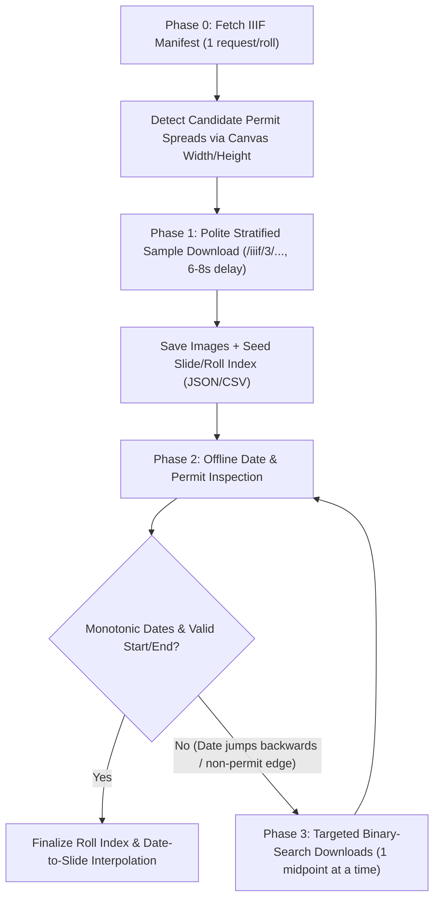

# Chicago Building Permits Microfilm Sampling & Indexing Plan

## 1. Key Findings from Research Guide, Manifest `806145`, and Site Policies

### UIC Research Guide ([researchguides.uic.edu/CBP/home](https://researchguides.uic.edu/CBP/home))
- **Scope**: ~90 digitized microfilm ledger books covering **1872–1954** (Books 8, 13, 17, and 18 are missing from the original 1950s microfilm).
- **Two-page spreads**: Each digitized slide typically contains **2 physical ledger pages**, so the slide number in the viewer is roughly half the physical ledger page number (plus front-matter offset).
- **Date layout changes by era** (confirming why full-spread offline sampling is the right first step):
  - **Pre-1912**: Spreadsheet-style rows across a 2-page spread. The year appears in the **upper-left corner**, with month/day running down the left column (not every row repeats the date).
  - **1912–1913 transition → Post-1912**: Form-style layout with **6 permits per page (12 permits per spread)** ordered chronologically **down each page, then left to right**. Dates are frequently faintly stamped or omitted on individual entries, requiring comparison with adjacent permits on the spread.
- **Multi-region ledgers & legibility**: Books may cover one or multiple city regions (North, South, West, Northwest/Southwest, or annexed towns like Lakeview / Hyde Park), and some frames are damaged or illegible from brittle microfilm.

### Manifest `806145` Inspection ([manifest/806145](https://digital.library.uic.edu/iiif/manifest/806145))
- **Format**: IIIF Presentation API 3.0 (`@context: http://iiif.io/api/presentation/3/context.json`)
- **Title**: `Chicago Building Permits, Book A, Chicago: Feb 21, 1872 - July 20, 1875`
- **Identifiers**:
  - Manifest ID: `806145`
  - Reel UID: `CBPC_LB_01_01` (`CBPC_LB_01_0001.tif` – `CBPC_LB_01_0049.tif`)
  - ARK Identifier: `ark:/81984/d3j38ks81` (Permalink: `https://n2t.net/ark:/81984/d3j38ks81`)
  - UIC Viewer Homepage: `https://digital.library.uic.edu/view/806145`
- **Canvas Geometry Signal (Zero-Image Front-Matter Detection)**:
  - The manifest has **49 canvases** (`p1`–`p49`).
  - `p1` (`2680×3205`), `p2` (`2735×2215`), and `p3` (`2175×2785`) are portrait/squarish covers or microfilm target cards.
  - **`p4` through `p49`** are all wide landscape spreads (`5000 × 2954–3177`, aspect ratio ~1.57–1.69).
  - Inspecting canvas dimensions in the manifest before downloading automatically narrows the permit range to `[p4 .. p49]` without wasting image requests on title targets.

### Cloudflare & `robots.txt` Policy Check
We checked `https://digital.library.uic.edu/robots.txt`, `/view/806145`, and the IIIF endpoints directly:
- **HTML Viewer (`/view/...`)**: Protected by Cloudflare Managed Challenge (`HTTP 403`, `cf-mitigated: challenge`) for non-browser clients. **Do not scrape `/view/`, `/browse/`, or `/search`.**
- **IIIF & OAI-PMH (`/iiif/` and `/oai`)**: Explicitly permitted in UIC's `robots.txt`:
  ```text
  # OAI-PMH harvesting and IIIF must stay reachable.
  Allow: /oai
  Allow: /iiif/
  Crawl-delay: 5
  ```
  Both the IIIF manifest and IIIF Image API 3.0 endpoint (`https://digital.library.uic.edu/iiif/3/<image_id>/info.json`) returned `HTTP 200` cleanly with `access-control-allow-origin: *` and Cloudflare edge caching (`cache-control: public, max-age=86400`).
- **Precomputed Pyramid Sizes**: The IIIF Image API 3.0 server (`profile: level2`) advertises precomputed widths: `156`, `313`, `625`, `1250`, `2500`, and `5000` px. Requesting a pyramid width (`1250,` or `2500,`) minimizes origin CPU load and bandwidth.

> [!IMPORTANT]
> UIC's `robots.txt` specifically notes: *"Only well-behaved crawlers honour it. A scraper rotating User-Agents ignores it: that is what the Cloudflare WAF rules and rate limiting are for."* Staying strictly on `/iiif/`, using a single consistent custom User-Agent, and honoring `Crawl-delay: 5` is the safest way to avoid blocks.

---

## 2. End-to-End Indexing & Sampling Workflow



### Phase 0 — Manifest-Only Preflight
1. Fetch and cache `manifest_<id>.json` locally (never re-fetch a cached manifest).
2. Extract roll metadata (`title`, `reel_uid`, `ark_id`, `date_range`, `homepage`, `total_canvases`) and every canvas record (`slide_index`, `canvas_id`, `label`, `iiif_image_id`, `width`, `height`).
3. Classify candidate permit spreads via geometry:
   - Compute median width and aspect ratio across all canvases.
   - Mark canvases with `width > height` and `width >= 0.8 * median_width` (or aspect ratio `>= 1.25`) as `is_spread_candidate = true`.
   - Identify `first_spread` and `last_spread`.

### Phase 1 — Stratified Sample Selection
For each ledger roll with `N` candidate spreads `[first_spread .. last_spread]`:
- **Required Boundary Anchors**:
  - `first_spread` and `first_spread + 1` (covers cases where the first landscape spread is an index, flyleaf, or damaged page).
  - `last_spread - 1` and `last_spread` (covers blank endpages or end-of-reel targets).
- **Interior Sampling Stride** (scales cleanly from short ledgers to 500+ slide ledgers):
  - **Small rolls (`N <= 60`)**: ~8–10 interior slides (every ~5 slides) + 4 anchors → **~12 total slides**.
  - **Medium rolls (`61 <= N <= 250`)**: ~14–18 interior slides (every ~12–15 slides) + 4 anchors → **~18–22 total slides**.
  - **Large rolls (`N > 250`)**: ~24–30 evenly spaced slides (every ~20–30 slides) + 4 anchors → **~28–34 total slides**.
- **Concrete Pilot Sample for Manifest `806145` (Book A, 49 canvases, `p4`–`p49` spreads)**:
  - **12 slides**: `p4, p5, p9, p13, p17, p21, p25, p29, p34, p39, p44, p48, p49` (13 slides, ~1.5 minutes total at 6–8s delay).
  - Optionally `p1` at thumbnail width (`500,`) to visually confirm the ledger title card.
- **Region & Resolution Choice (Verified in Pilot)**:
  - Default to a **top-25% full-width IIIF crop** at **`2500,` px wide** (`https://digital.library.uic.edu/iiif/3/<image_id>/pct:0,0,100,25/2500,/0/default.jpg`).
  - Why a single top strip instead of two separate corner requests: it takes **1 HTTP request per slide** (halving requests and wait time), downloads only **~100–195 KB** per slide, and captures **both** top-left and top-right page numbers, headers, and starting dates — including first-spread edge cases like Book A `p4`, where the left page is blank inside cover and Permit #1 starts on the right page.
  - Configurable via `--region` (e.g., `pct:0,0,35,35`, `pct:0,0,100,30`, or `full`) and `--width` (`1250`, `2500`, `max`) for eras where dates sit lower on the page.

### Phase 2 — Polite Downloader & Anti-Block Safeguards
- **Allowed Endpoints Only**: Only hit `https://digital.library.uic.edu/iiif/manifest/<id>` and `https://digital.library.uic.edu/iiif/3/<image_id>/full/<width>,/0/default.jpg`.
- **Single-Threaded Sequential Queue**: `concurrency = 1`, single persistent HTTP/2 or Keep-Alive session.
- **Rate Limiting**: Sleep **6.0–8.0 seconds** (honoring `Crawl-delay: 5` plus uniform jitter) between requests.
- **Consistent Identification**: Single descriptive `User-Agent` header (e.g., `ChicagoBuildingPermitsIndexer/1.0 (personal historical research)`), no UA rotation, never spoofing browser or blocked-bot strings.
- **Idempotency & Resume**: Check local cache before requesting; write atomically (`*.part` → rename); record every fetch in a local SQLite/JSONL download log.
- **Circuit Breaker**:
  - On `HTTP 429` or `503`: obey `Retry-After` or back off exponentially (`30s → 60s → 120s`, max 3 retries).
  - On `HTTP 403` or `cf-mitigated` header: **abort immediately** and save state so you never escalate into a longer IP block.

### Phase 3 — Offline Date Analysis & Multi-Region Flagging
Once sample images are local, analyze them offline (manually, or with a local review UI / vision-assisted extraction pass):
1. Record per sampled slide:
   - `slide_type` (`permits`, `cover`, `blank`, `index`, `illegible`)
   - `date_start`, `date_end` (ISO `YYYY-MM-DD`, noting `estimated` if faint/inferred)
   - `ledger_page_left`, `ledger_page_right` (physical printed page numbers if visible)
   - `permit_no_min`, `permit_no_max`
   - `region_note` (if a region header/divider is visible)
2. Run an automated **offline anomaly checker** across consecutive permit slides `(i, i+1)`:
   - **`OUT_OF_ORDER` (Multi-Region Candidate)**: `date_start[i+1] < date_start[i]` (with a small tolerance, e.g. > 7 days backwards, to ignore minor out-of-order entries on a single spread).
   - **`BOUNDARY_SHIFT`**: `first_spread` is not a permit page (walk forward) or `last_spread` is not a permit page (walk backward).
   - **`DATE_COVERAGE_MISMATCH`**: Observed min/max dates deviate significantly from the manifest title's date span (signals an unindexed section near the start/end).
   - **`ILLEGIBLE_ANCHOR`**: Sampled slide cannot be read; queue `slide ± 1` for the next pass.

### Phase 4 — Targeted Binary-Search Refinement (Pass 2+)
Only for intervals `[slide_a, slide_b]` flagged `OUT_OF_ORDER`:
- Queue the midpoint `mid = (slide_a + slide_b) // 2` into the same polite downloader.
- Inspect offline and bisect until `slide_b - slide_a <= 1` (typically **3–5 extra slides** per region break).
- Split the roll into contiguous, monotonic **segments** in the final index:
  - e.g., Segment 1: slides `4–142` (`North`, `1891-07-21` → `1894-04-30`)
  - Segment 2: slides `143–280` (`South`, `1891-07-22` → `1894-04-29`)

---

## 3. Index Data Model & Linking URLs for Your Application

Storing all canonical identifiers per roll and per slide ensures your downstream application can link reliably regardless of whether users open UIC's viewer, an embedded IIIF viewer, or a direct image:

### Roll Index (`rolls.json` / `rolls.csv`)
| Field | Example (`806145`) | Purpose |
| :--- | :--- | :--- |
| `manifest_id` | `806145` | Primary roll key |
| `reel_uid` | `CBPC_LB_01_01` | UIC official Reel UID (for citation/support) |
| `ark_permalink` | `https://n2t.net/ark:/81984/d3j38ks81` | Persistent archival URL |
| `viewer_url` | `https://digital.library.uic.edu/view/806145` | Human-facing UIC Digital Collections page |
| `manifest_url` | `https://digital.library.uic.edu/iiif/manifest/806145` | IIIF v3 manifest (CORS-enabled) |
| `title` | `Chicago Building Permits, Book A, Chicago: Feb 21, 1872 - July 20, 1875` | Ledger label |
| `era` | `pre-1912` | Layout hint (`pre-1912` / `transition` / `post-1912`) |
| `total_canvases` | `49` | Total slides in roll |
| `first_permit_slide` | `4` | First confirmed permit slide (1-based) |
| `last_permit_slide` | `49` | Last confirmed permit slide (1-based) |
| `multi_region_flagged` | `false` | Set `true` if date reset detected |

### Slide Sample & Anchor Index (`slides.json` / `slides.csv`)
| Field | Example (`806145`, slide 4) | Purpose |
| :--- | :--- | :--- |
| `manifest_id` | `806145` | Foreign key to roll |
| `slide_index` | `4` | 1-based slide number (matches UIC viewer's top jump box) |
| `canvas_index` | `3` | 0-based index for IIIF viewers (`cv=3`) |
| `canvas_id` | `https://digital.library.uic.edu/iiif/806145/canvas/p4` | Canonical IIIF Canvas URI |
| `iiif_image_id` | `2175395` | Underlying IIIF Image API identifier |
| `iiif_image_url` | `https://digital.library.uic.edu/iiif/3/2175395/full/2500,/0/default.jpg` | Direct IIIF image URL (adjustable width) |
| `iiif_viewer_link` | `https://uv-v4.netlify.app/#?manifest=https://digital.library.uic.edu/iiif/manifest/806145&cv=3` | Direct slide deep-link via any IIIF viewer (or your app's embedded viewer) |
| `uic_viewer_url` | `https://digital.library.uic.edu/view/806145` | UIC native page (pair with `"Image 4 of 49"` in UI) |
| `width` / `height` | `5000` / `3123` | Canvas dimensions |
| `local_path` | `data/806145/slides/p0004_2175395.jpg` | Downloaded sample file |
| `observed_date_start` | *(filled offline)* | Earliest date on spread |
| `observed_date_end` | *(filled offline)* | Latest date on spread |
| `order_status` | `pending` / `ok` / `out_of_order` / `non_permit` | Anomaly flag |

> [!TIP]
> **Deep-linking straight to a slide in your app**: Because UIC's `/iiif/` endpoints serve `access-control-allow-origin: *`, you can either embed a lightweight IIIF viewer (Clover, Mirador, or Universal Viewer) pointed at `manifest_url` + `canvas_index`, link directly to `iiif_image_url`, or link to `viewer_url` alongside the 1-based `slide_index` (and if UIC's browser viewer exposes a page URL parameter when you open `/view/806145` in a browser, we can easily plug that template into the index generator).

---

## 4. Proposed Implementation Structure

Create a small, standalone Python project (standard library only or `requests`) in `/home/timblackburn/projects/uic_permit_index/`:
- `fetch_manifest.py` — Fetches/caches a manifest (or batch of manifests) and builds the full canvas catalog + spread-candidate detection.
- `sample_download.py` — Computes the stratified sample (or accepts explicit slide numbers for Pass-2 bisection), downloads images sequentially at `6–8s` delay with circuit-breaker protection, and updates `index/rolls.json` and `index/slides.csv`.
- `check_order.py` — Reads offline-annotated dates from `slides.csv`, flags `OUT_OF_ORDER`, `DATE_COVERAGE_MISMATCH`, and `NON_PERMIT` slides, and outputs the exact midpoint slides needed for Pass-2 refinement.
- `data/<manifest_id>/` — Cached `manifest.json`, downloaded `slides/pXXXX_<img_id>.jpg`, and `download_log.jsonl`.

---

## 5. Verification Plan
1. Run `fetch_manifest.py` on `806145` (uses the already-fetched manifest, 0 extra requests) and verify all 49 canvases and spread candidates (`p4`–`p49`) parse cleanly.
2. Run `sample_download.py` in `--dry-run` mode first to print the exact 12–13 URLs, estimated runtime, and output paths.
3. Execute the pilot download on `806145` (~1.5 min total) and verify HTTP 200 responses, valid JPEGs, and legibility of dates at `2500px` wide (checking `p4` and `p49` specifically to confirm permit start/end).
4. Test `check_order.py` with synthetic out-of-order dates to verify multi-region flagging and bisection midpoint suggestions before analyzing real dates offline.
